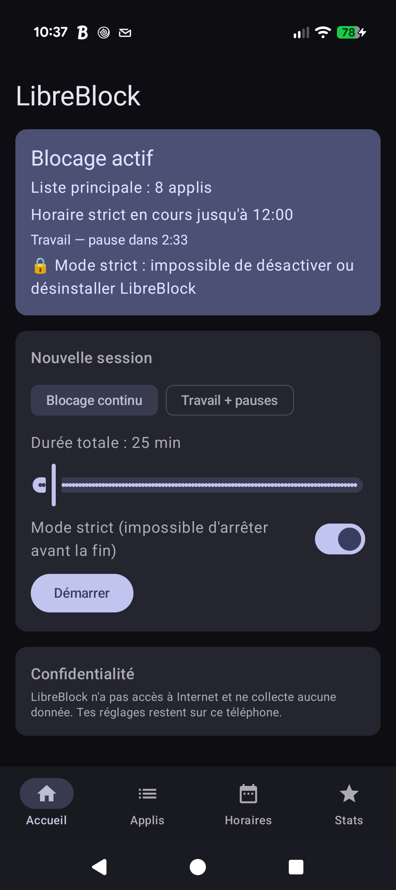
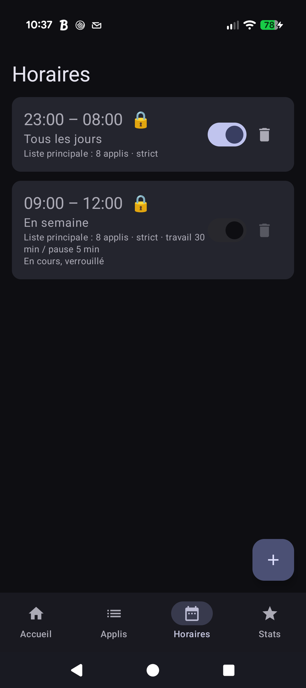
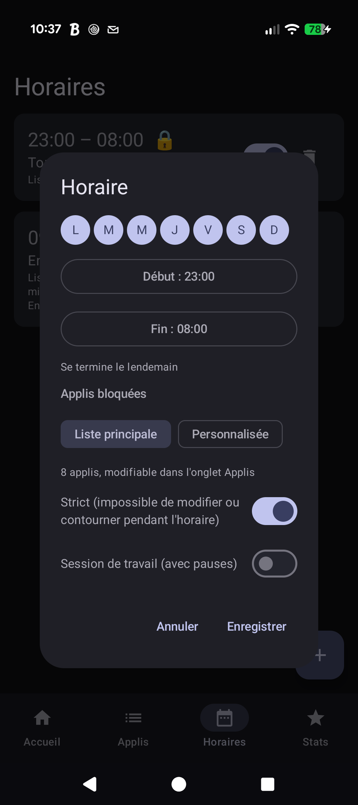
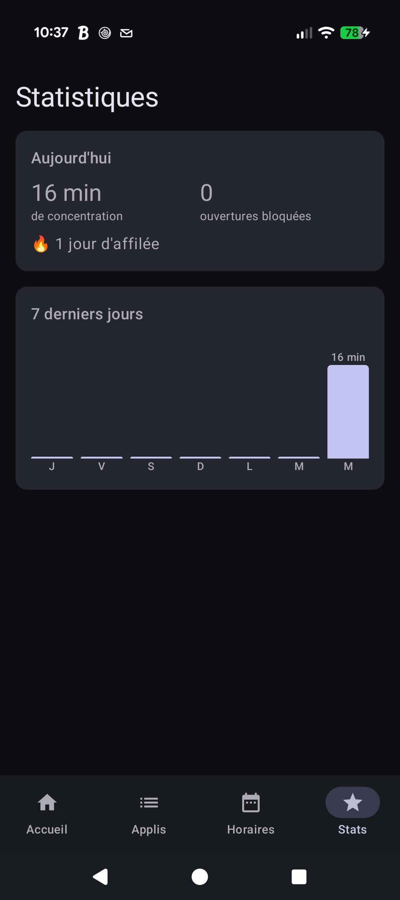

# LibreBlock

Bloqueur d'applis Android gratuit, sans pub, sans compte, sans accès à Internet.

<p>
  
  
  
  
</p>

## Fonctions
- **Sessions de concentration** : blocage immédiat de 5 min à 8 h.
- **Sessions de travail** : alternance travail / pause (25 / 5 min par défaut), avec une notification à chaque changement.
- **Horaires** récurrents par jour de la semaine, y compris de nuit (ex. 23:00 – 08:00). Chaque horaire utilise la
  liste principale ou sa propre liste, et peut être souple ou strict.
- **Limites quotidiennes** : temps maximal par jour dans une appli, puis blocage jusqu'à minuit, avec un
  avertissement 5 min et 1 min avant. Baisser une limite s'applique tout de suite ; l'augmenter ou la supprimer,
  seulement le lendemain.
- **Mode « tout bloquer sauf »** : chaque liste bloque soit les applis cochées, soit toutes les autres.
- **Mode strict** : impossible d'arrêter le blocage, de rendre une liste moins stricte, de désactiver le service ou
  de désinstaller l'appli tant que la session ou l'horaire strict est en cours.
- **Statistiques** : temps de concentration, ouvertures bloquées, série de jours, 7 derniers jours, applis les
  plus bloquées. Gardées 60 jours, sur le téléphone uniquement.

## Garde-fous
Pour qu'on ne puisse jamais bloquer complètement son téléphone :
- l'écran d'accueil, l'appli Téléphone par défaut (urgences) et LibreBlock ne peuvent pas être bloqués ;
- les horaires stricts, même cumulés, doivent laisser au moins 2 heures libres d'affilée toutes les 24 h
  (les trous plus courts comptent comme verrouillés) ; une session stricte manuelle dure au plus 8 h.

Et pour qu'on ne puisse pas contourner le mode strict :
- changer l'heure ou le fuseau du téléphone pendant un blocage strict est neutralisé (l'appli suit le temps
  écoulé depuis le démarrage, impossible à modifier) ; le passage heure d'été / heure d'hiver n'est jamais
  pris pour une manipulation, et un horaire de nuit se termine à la bonne heure locale ce jour-là.

## Raccourcis
- **Notification permanente** pendant une session ou un horaire, avec compte à rebours jusqu'à la prochaine pause.
- **Tuile des réglages rapides** « LibreBlock » : démarre une session avec les derniers réglages, ou l'arrête.

## Architecture
Interface **sans état** (Jetpack Compose, Material 3) → **ViewModel** (règles du mode strict et garde-fous) →
**dépôt** unique sur **DataStore**, partagé avec le service d'accessibilité et la tuile.

| Fichier | Rôle |
|---|---|
| `Model.kt` | Modèle immuable (`Settings`, listes, horaires, sessions, stats) et toute la logique, pure et testée en JVM |
| `SettingsRepository.kt` | Source unique : fichier DataStore (JSON), état en mémoire (`StateFlow`), reprise des anciens réglages |
| `MainViewModel.kt` | État de l'interface et règles appliquées avant chaque modification |
| `TrustedClock.kt` | Heure protégée contre les changements d'heure pendant le mode strict |
| `BlockerService.kt` | Service d'accessibilité : blocage, coupure du son, protection des Paramètres, notifications, statistiques |
| `MainActivity.kt`, `AppsScreen.kt`, `SchedulesScreen.kt`, `StatsScreen.kt`, `OnboardingScreen.kt` | Écrans |
| `BlockActivity.kt`, `SessionTileService.kt` | Écran « appli bloquée », tuile des réglages rapides |

Kotlin, Jetpack Compose, DataStore, Lifecycle, AGP 9 ; aucune dépendance hors AndroidX.

## Tests
- **Unitaires** (JVM, lancés par la CI) : horaires de nuit et changement d'heure, garde-fou du mode strict,
  heure de confiance, listes « tout bloquer sauf », statistiques, enregistrement et reprise des anciens réglages.
- **Interface** (Compose, sur appareil) : verrouillage des listes et des horaires stricts, horaire 24 h refusé,
  démarrage de session, statistiques. À lancer sur la copie séparée, que Gradle désinstalle ensuite :

```bash
gradlew.bat connectedDebugAndroidTest -Ppreview
```

La copie séparée est construite dans le même fichier que l'appli normale (`app-debug.apk`) : relancer
`gradlew.bat assembleDebug` sans `-Ppreview` avant d'installer l'appli sur son téléphone.

## Compiler
```bash
gradlew.bat testDebugUnitTest assembleDebug
```
Publication sur Google Play : voir [docs/publication.md](docs/publication.md).

## Activer le blocage
Dans l'appli : *Activer le blocage* → lire l'information → *J'accepte* → activer **LibreBlock** dans
l'accessibilité. Sur Android 13+, pour un APK installé hors Play Store, il peut falloir d'abord :
Infos de l'appli → ⋮ → *Autoriser les paramètres restreints*.

## Limites connues
- Changer l'heure du téléphone permet de contourner les horaires et les sessions.
- Le mode sans échec désactive les services d'accessibilité.
- Certaines surcouches (Xiaomi, Huawei…) arrêtent les services en arrière-plan : désactiver l'optimisation de
  batterie pour LibreBlock.

## Confidentialité
Aucune donnée collectée : voir [docs/privacy.md](docs/privacy.md).

## Licence
LibreBlock est un logiciel libre distribué sous licence [GNU GPL v3](LICENSE) : tu peux l'utiliser, l'étudier,
le modifier et le redistribuer, à condition de publier tes modifications sous la même licence.
