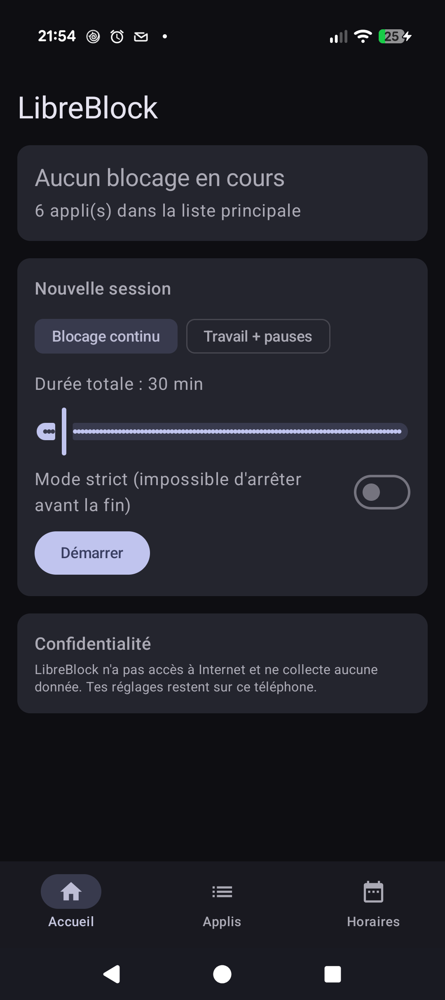
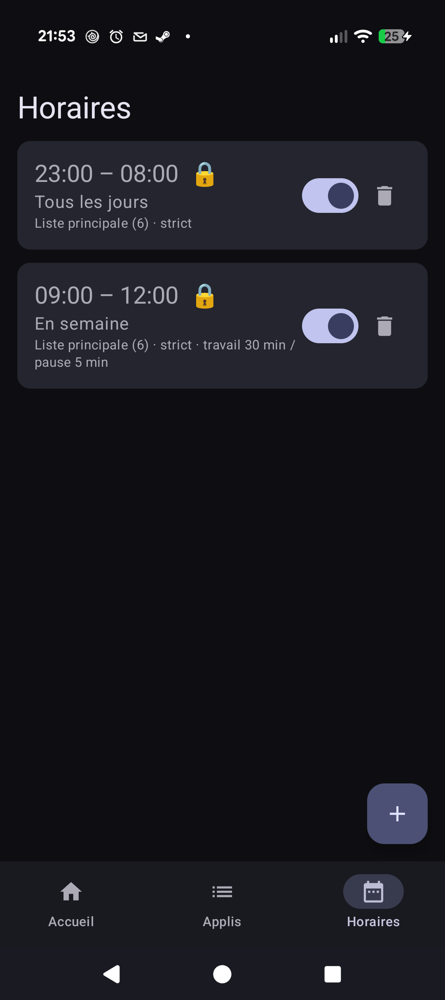
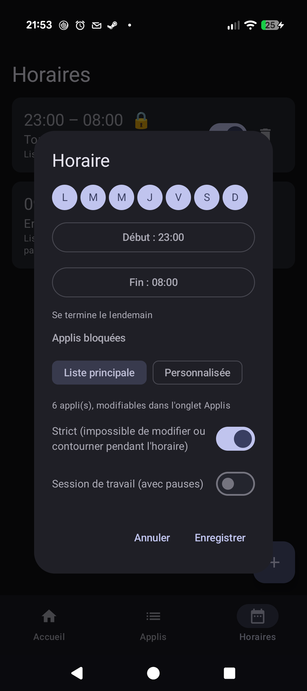

# LibreBlock

Bloqueur d'applis Android gratuit, sans pub, sans compte, sans accès à Internet.

<p>
  
  
  
</p>

## Fonctions
- **Sessions de concentration** : blocage immédiat de 5 min à 8 h.
- **Sessions de travail** : alternance travail / pause (25 / 5 min par défaut), avec une notification à chaque changement.
- **Horaires** récurrents par jour de la semaine, y compris de nuit (ex. 23:00 – 08:00). Chaque horaire utilise la
  liste principale ou sa propre liste, et peut être souple ou strict.
- **Mode strict** : impossible d'arrêter le blocage, de retirer des applis, de désactiver le service ou de
  désinstaller l'appli tant que la session ou l'horaire strict est en cours.

## Garde-fous
Pour qu'on ne puisse jamais bloquer complètement son téléphone :
- l'écran d'accueil, l'appli Téléphone par défaut (urgences) et LibreBlock ne peuvent pas être bloqués ;
- les horaires stricts, même cumulés, doivent laisser au moins 2 heures libres d'affilée toutes les 24 h
  (les trous plus courts comptent comme verrouillés) ; une session stricte manuelle dure au plus 8 h.

## Architecture
| Fichier | Rôle |
|---|---|
| `BlockerService.kt` | Service d'accessibilité : détecte l'appli au premier plan, affiche l'écran de blocage, protège les Paramètres en mode strict, notifie les pauses |
| `Store.kt` | Modèle (horaires, sessions, cycles travail/pause) et persistance en SharedPreferences |
| `BlockActivity.kt` | Écran « appli bloquée » |
| `MainActivity.kt`, `AppsScreen.kt`, `SchedulesScreen.kt` | Interface Jetpack Compose (Material 3) |
| `ScheduleTest.kt` | Tests unitaires : horaires de nuit, journées entières, cycles travail/pause |

Kotlin, Jetpack Compose, AGP 9, aucune dépendance hors AndroidX.

## Compiler
```bash
gradlew.bat testDebugUnitTest assembleDebug
```
Publication sur Google Play : voir [docs/publication.md](docs/publication.md).

## Activer le blocage
Dans l'appli : *Activer le blocage* → lire l'information → *J'accepte* → activer **LibreBlock** dans
l'accessibilité. Sur Android 13+, pour un APK installé hors Play Store, il peut falloir d'abord :
Infos de l'appli → ⋮ → *Autoriser les paramètres restreints*.

## Limites connues
- Changer l'heure du téléphone permet de contourner les horaires et les sessions.
- Le mode sans échec désactive les services d'accessibilité.
- Certaines surcouches (Xiaomi, Huawei…) arrêtent les services en arrière-plan : désactiver l'optimisation de
  batterie pour LibreBlock.

## Confidentialité
Aucune donnée collectée : voir [docs/privacy.md](docs/privacy.md).

## Licence
LibreBlock est un logiciel libre distribué sous licence [GNU GPL v3](LICENSE) : tu peux l'utiliser, l'étudier,
le modifier et le redistribuer, à condition de publier tes modifications sous la même licence.
